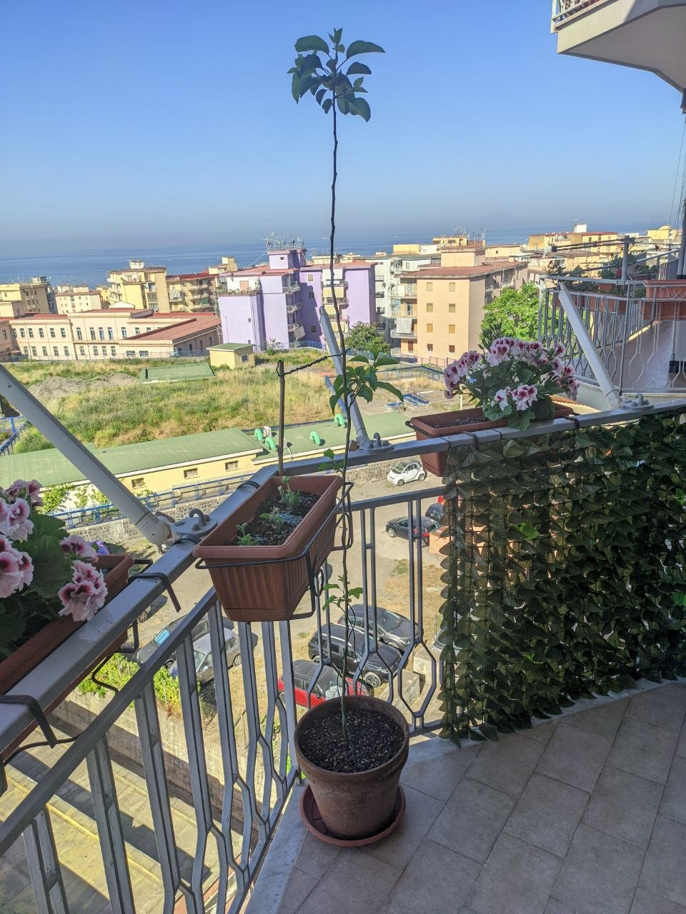
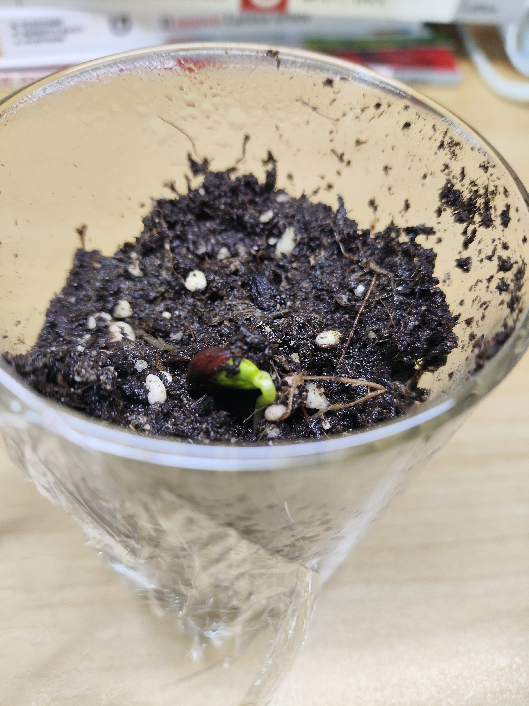

Anni fa, durante la pandemia, feci nascere un alberello da un semplice seme di Golden Delicious. Purtroppo, complice la mia inesperienza di allora, crebbe simile a un manico di scopa: lungo e sottile, alto quasi due metri. Una foto: 

Nell'estate del 2022, durante la mia assenza per le vacanze, nessuno poté prendersene cura. Io, che di solito lo ispezionavo ogni giorno a caccia di parassiti e malattie per stroncare ogni problema sul nascere, al mio ritorno lo trovai completamente infestato dagli afidi. Di lì a poco perse tutte le foglie; gli afidi se ne andarono solo quando non rimase più nulla da mangiare. Aspettai mesi sperando in un segno di vita, ma non ci fu nulla da fare. Dovetti dichiararlo morto, come segno rituale spezzai il tronco con le mani.
 

---

 
Da allora, ogni mela che mangiavo portava con sé il suo ricordo e un pizzico di rimorso. Qualche settimana fa, però, aprendo una mela rossa, ho notato che i semi erano già germinati al suo interno. Ho scelto i tre più promettenti e li ho interrati. Ecco il primo:

