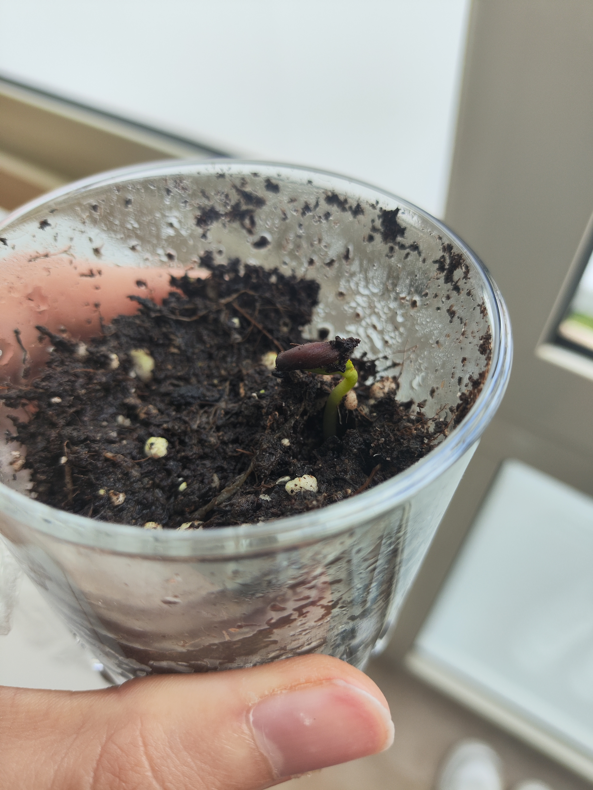

A un giorno di distanza, ecco la situazione di questa mattina. 

Come si vede dalla foto, la piantina sta spingendo verso l'alto con una forza incredibile. Ho fatto crescere tantissime cose ma è sempre affascinante osservare come bucano il terriccio e si orientano alla luce, con calma e passo inesorabile.  

# Progetto Bonsai

Lo guardo e penso che questa volta farò le cose in modo completamente diverso. Per questo nuovo inizio voglio farlo crescere come un bonsai. 

So che coltivare un melo partendo da seme e miniaturizzarlo richiederà anni di pazienza, studio e dedizione, ma è proprio questa la sfida che voglio affrontare. Voglio guidare la sua crescita, curarne la forma passo dopo passo e tenerlo in un vaso adatto, potendolo controllare e proteggere facilmente da qualsiasi insetto o malattia, comodamente in casa. 

Sarà un percorso lungo, ma questo "elmetto" mi sembra già pronto per l'avventura, proprio come un soldatino.

---

Sino ad ora avevo coperto il bicchiere di vetro con una pellicola, per avere un'umidità maggiore al fine di far germogliare i semini. Ora l'ho tolta per evitare marcescenza. Credo che nel giro di 2 giorni il terriccio si asciugherà quindi dovrò iniziare ad innaffiarlo quando necessario.