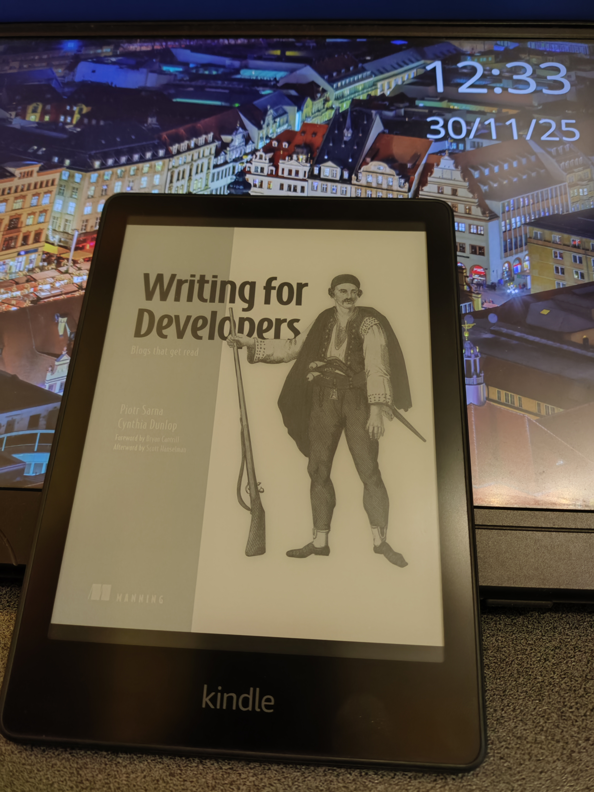

Stanotte mi sono imbattuto nel blog di Antirez (Salvatore Sanfilippo) ma non avevo sufficienti neuroni per poter digerire quello che aveva scritto pochi giorni fa nel [suo ultimo post](https://antirez.com/news/156). Contemporaneamente, non so che giri io abbia fatto ma sono capitato su una Repository di GitHub, [questa](https://github.com/scynthiadunlop/WritingForDevelopersBook)

Pertanto, stamattina dopo aver riposato un po', ho voluto analizzare la mole di dati e sono andato a ripescare entrambe le pagine.

## Il post di Antirez
Risulta essere mooolto tecnico ma è affascinante. Parla di HNSW (vettori per la ricerca di similarità) dentro Redis. Da quanto ho capito, ci sta lavorando da oltre 1 anno, ed ha condensato tantissime informazioni (non per newbies) in un post da 10 minuti di lettura. Elenca tutte le varie sfide, la latenza, la memoria, la complessità ed esempi di codice. Un layout brutalista, senza fronzoli, solo bianco e nero. Davvero, f a n t a s t i c o. 

## La repo su GitHub
Quasi per un gioco del destino, sono finito su Writing for Developers. Se il post di Antirez è l'esempio pratico di come scrivere un post tecnico/documentale, qui ti fornisce tantissimi altri post di programmatori. Ciò che mi ha ispirato è stato:
> “Writing is a way to garbage collect your thoughts into a clear narrative, not just for the audience but for the individual. Most content is noise and boring, and learning to distill the important makes you a clear thinker. It is a grueling process - for me - moving from frustration to eureka, especially if your wife is a literature major.[...]

### Il libro
Ho aggiunto alla libreria del mio Kindle il libro "Writing for Developers", consigliato proprio dai manutentori della repo, vedrò se mi ispirerà a scrivere qualcosa di più strutturato.
