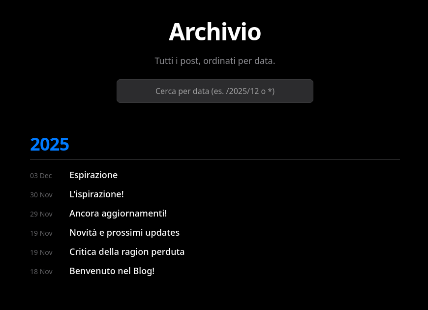

Apparentemente potrebbe sembrare che io mi sia dimenticato del blog e quant'altro. Non è propriamente così, ho lavorato sodo per uniformare l'esperienza utente tra il Portfolio, LiteraryLog e il Blog, pertanto ora che posso dire di aver concluso con le modifiche [non mi sembra di vedere altri errori], ho la voglia di raccontarvi tutto. Sarà un post più lungo del solito.

---

# Aggiornamenti al Portfolio e Blog
Ho un grande problema, possiedo un monitor UltraWide e quindi a volte dimentico di dover essere più inclusivo con i layout del blog. Odio la programmazione web ogni giorno, e queste cose me la fanno odiare sempre di più.

Ho lavorato sodo per uniformare l'esperienza utente tra il Portfolio e il Blog. Ecco le novità principali:

### 1. Navbar e Layout Unificati
La navbar del Portfolio/Blog è stata aggiornata per essere **visivamente identica** a quella di LiteraryLog.
- Ora sia Blog che Portfolio che LiteraryLog hanno la stessa larghezza massima di **1200px**. Questo significa che passando da un sito all'altro non ci sono più fastidiosi "salti" orizzontali del contenuto.

### 2. Indice un po' più intelligente
Ho modificato l'indice dei contenuti laterale in modo che si adatti allo schermo:
- **Desktop (>1750px)**: Appare a sinistra, ben spaziato.
- **Laptop (1250px - 1750px)**: Il contenuto del post si stringe leggermente (da 1200px a 800px) per far spazio all'indice, che si allinea perfettamente alla navbar.
- **Mobile/Tablet**: L'indice scompare per lasciare spazio al contenuto.

Dovrebbe garantire la visualizzazione dell'indice su qualsiasi dispositivo con più di 13 pollici.

Sto considerando di creare un pulsantino, tipo un triangolino per poterlo visualizzare di lato su dispositivi più piccoli, però non so. Penso che quasi nessuno legga post molto lunghi (da richiedere un indice) su uno schermo piccolo. Valuterò.

### 3. Migliorie visualizzazione post
- i **Tag** ora vanno a capo correttamente e hanno il giusto spazio, nella lista dei post.
- mentre ai **Titoli** ho sistemato la gerarchia dei font (`h2` > `h3` > `h4`) che prima non aveva regole per dispositivi più piccoli. Molto brutto, ora fixato.

### 4. L'Archivio!
Ho creato un archivio dei post, che si trova nel footer del blog, oppure [cliccando qui](/blog/archive/). Non vi dico nulla su come funzioni, seguite le semplici istruzioni.

--- 

## E LiteraryLog?

Cliccate [qui](https://panuozzo77.github.io/LiteraryLog/) e guardate il restyle. Su questo, non ho fatto nulla di speciale, ho solo chiesto a Gemini di fare un po' di magia. Fixettini di qua e di là ed è fatto. Il tasto dolente rimane sempre la visualizzazione delle copertine. Purtroppo non ho trovato un modo per farlo funzionare meglio.
> In realtà il modo c'è:
>- salvare tutte le copertine in una cartella, una per ogni id del libro salvato ed utilizzare quelle.
>- si evita così di avere una funzione che chiama GoogleBooks per ogni libro (dopo tot richieste c'è uno slow down) che funzioni lato client.

---

## Advent of Code
Sono alla terza giornata dell'advent of code. Sto usando C per risolvere i vari riddle ma sono meno ferrato di quanto immaginassi, quindi ci metto un po' per risolvere i problemi, però al momento non ho granché da fare quindi è tempo utilizzato in maniera costruttiva. Di solito mi metto a risolvere gli enigmi nel pomeriggio. Oggi (sono le 15:10) sono a metà giornata ma non ho nemmeno iniziato.

---

## Spostata la repo degli appunti
Nessuno di voi lo può sapere, tranne GitHub, ma ho una repository privata con tutti i miei appunti scritti con Obsidian, la aggiorno da un po', al momento pesa circa 300MB... 300MB di appunti, testuali, sono tantini.

Ultimamente l'ho utilizzata per tenere traccia dello stato delle candidature inviate, tutti i CV utilizzati per ciascuna azienda e tutte le figure professionali a cui ho pensato di candidarmi ed i requisiti necessari per ricoprire il ruolo.

Ho fatto application a 66 annunci.

Beh, a quanto pare non serve a molto perché sono ancora disoccupato 🥱

### Dove ho spostato la repo??

Semplice! sto usando il serverino come 'server' Git invece di GitHub. Avevo letto [sul sito ufficiale di Git](https://git-scm.com/book/en/v2/Git-on-the-Server-The-Protocols.html) che fosse possibile questa cosa e mi sono fiondato. Non so come non avevo mai pensato di farlo prima [...] 
>[non è vero, ho sempre procrastinato la soluzione di questo problema ma non sapevo che si potesse usare Git così] 

[...] specie per le cose private che vorrei evitare fossero archiviate da qualche parte nel mondo. 
 È stato facilissimo, letteralmente 1 comando via CLI dal server ed un altro dal mio computer. Magia pura, amo Git.

Non è per questione di privacy o non so che, perché questa tipologia di appunti non è nulla di sensibile, non c'è nemmeno un codice fiscale. Semplicemente, è evitabile.
- **CONS**: ho perso una cosa come 500 commit nell'ultimo anno dal mio profilo GitHub. Il mio ego è stato ferito. 

---

## Termostato Zigbee
Ho comprato un termostato Zigbee della Moes a circa 20€ su Aliexpress. Ha qualche Défaillance:
- Quando si ordina di raggiungere una certa temperatura, non raggiunge mai quella temperatura. Perché? Perché improvvisamente la temperatura che legge il sensore del termostato invece di salire, esattamente come fa quando invece è in standby, inizia a calare. E penso sia un problema di programmazione del firmware.
- Dopo aver provato varie volte la connessione al dongle ZigBee, ha smesso di fare il pairing.
- Nonostante le prime volte il pairing avvenisse con successo, né zigbee2mqtt né Home Assistant sono in grado di 'identificare' il dispositivo e trovare le giuste configurazioni per 'telecomandarlo.
- Ho trovato una [discussione su GitHub](https://github.com/Koenkk/zigbee2mqtt/discussions/29480) di alcuni tizi che hanno creato un file di configurazione che sia in grado di farlo funzionare. Purtroppo gli aggiornamenti da parte loro sono dei tentativi nel vuoto e mi scoccio di andare a controllare giorno per giorno le novità (non sempre ci sono). Ad esempio, proprio ora che sto postando ho scoperto che ieri (03-12-2025) un tizio ha scritto questo:
>Thanks for all your work to get to a working external converter. I spent a lot of time with AI trying to build a working quirk for this thermostat on ZHA before. Since I was having so much trouble getting the datapoints from debugging as pressing the thermostat buttons wouldn't show anything on logs, I was cheeky and reached out to Moes' customer service and asked for them. They were great about it and sent me the specs today, you can access them here: https://github.com/m-Mojo-m/Datapoint-Specification-for-TS0601-_TZE284_rlytpmij/blob/main/protocol_rlytpmij_20251203.pdf
>
>I think next I'll see if AI can read this protocol and maybe build on your code to get stuff like the schedule, temp offset and eco mode working.

Insomma, è tutto un work in progress, c'è gente che ci sta mettendo una pezza sopra utilizzando il proprio tempo. Cosa che l'azienda invece non ha fatto. Non sono molto soddisfatto di tutto ciò.