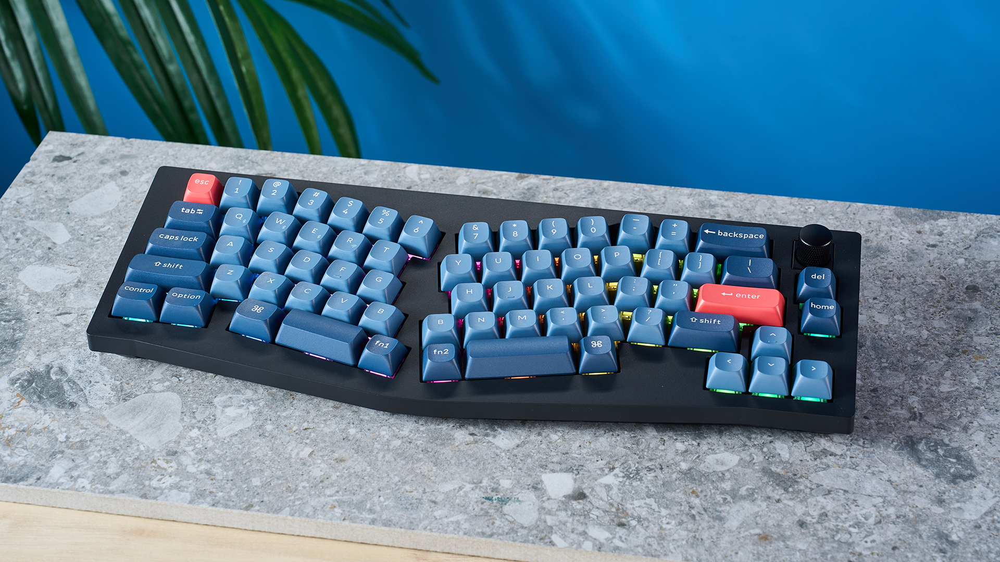

Ecco, ce l'ho fatta. Ho un lavoro. Sono felice, è il mio primo lavoro. E NON È UNO STAGE, NON È UN APPRENDISTATO, NON È UN TIROCINIO.

Potrò dire di pagare le tasse e quindi di lamentarmi di come lo stato sperperi 'issoldi dei contribbuendi!'

---

# Realizzazione

Sono felice ma anche sollevato. Ogni giorno che passava senza un lavoro dalla laurea mi rendeva più nervoso, più insicuro della mia scelta di attendere 1 anno prima di immatricolarmi per la magistrale. Questo è un capitolo ad una realtà tutta nuova ancora una volta tutta da scoprire. 

---

## Problemi

Volete sapere quali sono i miei problemi in merito? Non possiedo una custodia per poter trasportare la mia Keychron V8 Max, questa in foto: 

e trovo orribile pensare di non scrivere con questa tastiera che è praticamente burro. 

Nei giorni passati ho cercato tastiere low-profile pieghevoli, ma non ho trovato nulla di soddisfacente. Volevo qualcosa con il cavo, low-profile, pieghevole, non necessariamente meccanica, sotto i 50$ circa da portare in ufficio ed in viaggio. Ma tutte quelle ultrasottili sono wireless o bluetooth. Quindi ho ripiegato per acquistare una custodia per la tastiera che già ho. Così ho preso le misure e con molta pazienza e tante ricerche ho capito che ha dimensioni molto simili a quella di una TenKeyLess ed ho acquistato una custodia. Arriverà domani 13/12. Dovrebbe andare proprio a pennello, circa 2mm di spazio orizzontale e circa 6mm di spazio verticale. 

Ho anche un poggiapolsi in legno. Purtroppo quello lo dovrò lanciare nello zaino assieme a tutto il resto, spero non si rovini troppo.

# Fine

Sono stato disoccupato per 80 giorni da quando mi sono laureato. 

Ciò che spero accada è avere nuovi spunti per il blog mentre lavoro. Magari scrivere proprio un bel post tecnico su qualcosina che mi ha fatto impazzire. Sarebbe davvero fantastico.