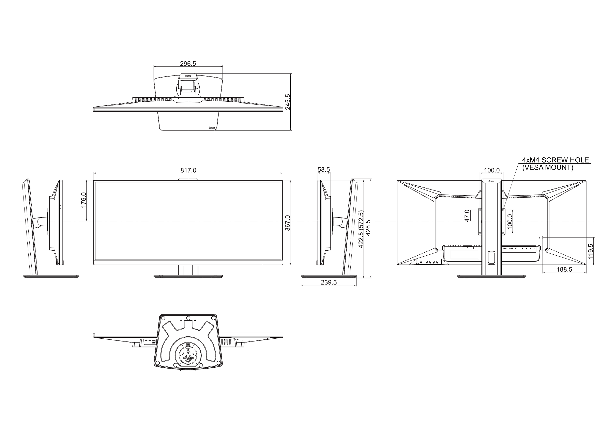
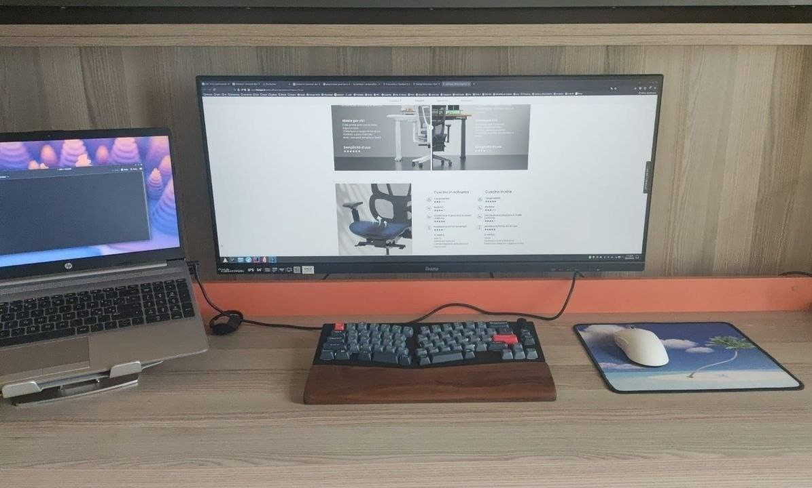

# Setup precedente

Dall'8 Giugno 2022 ho utilizzato un LG 29WK600-W, un grande classicone... 29" 21:9 preso usato per 100€, ricordo avesse un uso totale di 12hx365x2 ore (poco sotto le 9000h), insomma, aveva lavorato per benino. Ad oggi, ne ha accumulate in totale 19489. 
  <u>Una media di 2700h annue, 7h al giorno tutti i giorni.</u>

> Impossibile averlo usato così, perché andavo e tornavo dall'Università. Semplicemente era acceso dalla mattina alla sera solo i giorni che ero a casa per i progetti (personali e non) o per giocare.

## Motivazioni

Il monitor beh, era usato ed in ottimo stato, tutt'oggi è ancora qui con me sul mio secondo setup. Però sulla nuova postazione avevo alcune difficoltà:
- il piedistallo stock:
    - era abbastanza basso, con la nuova scrivania doveva essere rialzato.
    - occupava spazio inutilmente. La situazione si aggravava con l'impiego di un rialzo (ho utilizzato una risma di fogli).
- il refresh rate non è al passo coi tempi
    - sebbene io non faccia giochi competitivi, noto un'enorme differenza fino ai 140Hz.
    - 75Hz sono troppo pochi per essere apprezzati.
- volevo qualcosa di più cazzuto _e nuovo_, visto che posso permettermelo. Bigger is better, right?
- considerando la permanenza dell'installazione a muro, volevo qualcosa che fosse valido e 'allo stato dell'arte'. 
    - Sarebbe stato un peccato forare il legno per montare un monitor _vecchio_ e non riuscire a poter effettuare un upgrade a distanza di anni perché i fori non sarebbero stati nel posto giusto. 

## Perché non un oled?

Ho provato in passato 2 oled:
- MATOS Unreal OL2701 (restituito, 5 marzo 2025)
- Philips 27" modello 2021 sconosciuto (provato a casa di un amico)

Probabilmente la situazione è cambiata con l'avanzare delle tecnologie dei pannelli, sub-pixel rendering e quant'altro, ma ho riscontrato grande affaticamento alla vista durante poche ore di utilizzo nel coding. Il che mi portava a bocciarli, siccome è la mia attività principale; il gaming non è minimamente contemplato tra le mie abitudini.

# L'acquisto

Ho acquistato lo iiyama ProLite XUB3493WQSU-B6, un ottimo IPS 34" opaco. Ho deciso di montarlo a muro per liberare tutto lo spazio sulla mia scrivania, fa la sua porca figura, poi con tutte le periferiche wireless dà una sensazione di ordine incredibile. Soddisfattissimo.

## Cosa mi ha spinto ad acquistarlo

Prima di acquistare questo monitor specifico, mi sono assicurato che **le misure** fossero 
  p e r f e t t e   
infatti ho ricontrollato un milione di volte tutte le grandezze, tra cui lo spessore, e fatto delle approssimazioni su dove avrei dovuto forare il legno e di quanto sarebbe sporto. Alla fine, una volta arrivato a destinazione ho potuto verificare le mie teorie: la piastra VESA l'ho dovuta posizionare circa mezzo centimetro (4mm) più sotto di quanto ipotizzato, ci sono andato vicinissimo, direi che la mia abilità di astrazione e progettazione hanno funzionato alla grande.
  Perché tutto questo è importante? Perché è uno schermo abbastanza grande e deve essere allineato alla propria vista da seduti. Un'altezza scorretta affaticherebbe la vista più del dovuto ed il mio lavoro è già conosciuto per essere 'stressante' per gli occhi. 

La **seconda** motivazione è che il pannello è opaco, io li adoro. Quasi tutti i monitor che si trovano su internet sono molto spesso lucidi, alcuni fanno proprio effetto specchio, li detesto con ogni cellula del mio corpo. 

La **terza** cosa che ho adorato è che tutti gli attacchi sono orientati verso il basso, a differenza del mio LG che 'escono' in perpendicolare da dietro. Questo facilita di molto l'installazione a filo.

La **quarta**, che non ho ancora avuto modo di godere appieno è che il monitor possiede un hub USB: 2xUSB3.0 e 2xTypeC. Posso successivamente con 1 solo cavo 'distribuire' tutte le USB del monitor al PC di turno. Molto utile per fare Laptop-Swap senza perdere tempo a staccare e riattaccare mouse, tastiera e altro.

# Verdetto

 
Work in Progress
 

Dal primissimo istante che l'ho acceso non ho nulla di cui lamentarmi. Però aspetterò per tirare le somme. Oggi è il 7 Marzo, aspettiamo almeno la fine del mese, quando avrò utilizzato il monitor effettivamente per lavorare...