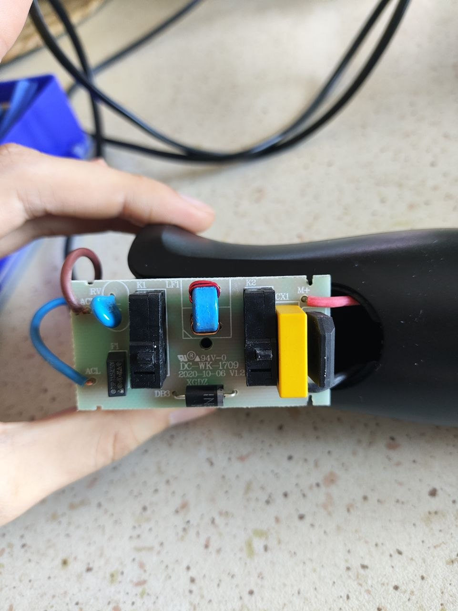
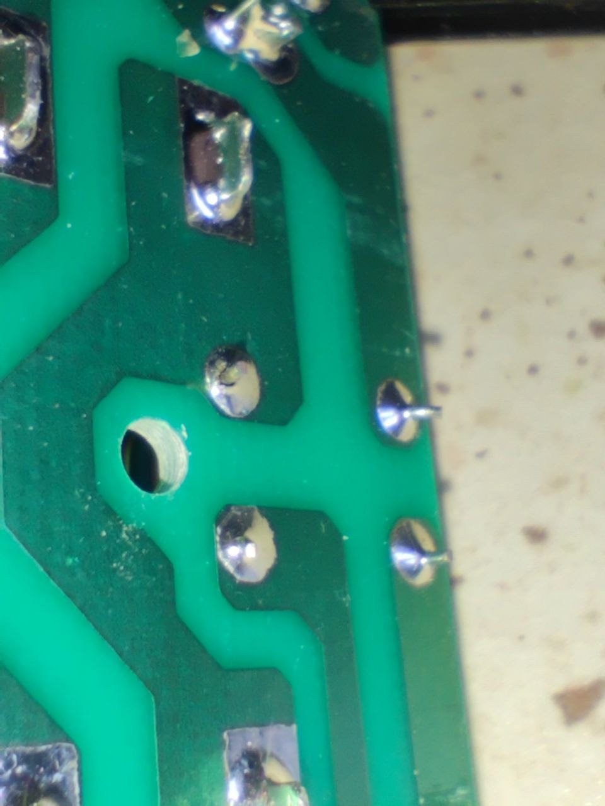

Bentrovati, voglio inserire questa vicenda nella lista di racconti di questo blog perché è qualcosa che mi ha fatto tremendamente piacere e secondo me merita di essere riportata.

# In medias res

Sono le 11:30 stai preparando il pranzo del sabato, vuoi una cosa veloce, decidi di fare il pesto. Prendi: basilico, pinoli, olio, aglio, inserisci tutto nel recipiente graduato del frullatore ad immersione, lo attacchi alla presa e... premi il pulsante, non fa alcun suono. Incredulo, cambi presa sperando sia solo un brutto scherzo, ma il risultato non cambia. Panico.

# Geeeminiiii

Parto subito svitando e smontando il frullatore ad immersione, 5 semplicissime vite ed una parte ad incastro. Raggiungo subito il circuito che altro non è che l'alimentatore per il motore e 2 bottoni per le velocità. 
Mando la foto (che trovate in basso) a Gemini chiedendogli: "ho un tester, mi è morto il frullatore, aiutami a capire cosa non funziona".

 
Eseguiamo tutta la perizia: contatti, cavi, la resistenza, l'induttore, rotazione del motore, il BRIDGE RECTIFIER. Tutto risulta perfettamente funzionante. Allora Gemini mi consiglia di dare un'occhiata molto più scrupolosa ai piedini presenti nel retro della scheda, alla ricerca di fuliggine o 'micro-fratture'. E incredibilmente, ecco a voi la frattura:

Così, armato di saldatore ed un po' di stagno ho eseguito una risaldatura sul piedino. 

Inserisco il frullatore nella presa di corrente, funziona!

## Considerazioni

Gli LLM hanno raggiunto livelli di conoscenza tremendi in ormai ogni settore e non c'è più un'informazione che non possano processare. In questo caso, sono bastate una semplice fotografia e poche righe di testo in cui spiegavo la situazione e i risultati dei test sui componenti. 
Abbiamo applicato un troubleshooting a step dove il focus si è spostato da una problematica all'altra, fino a giungere alla vera causa. 

### Protesi Cognitiva

Le mie competenze in elettronica sono molto basiche, ho comprato un tester* proprio per queste occasioni, ovvero per confermare se non ci sia più nulla da fare su un elettrodomestico prima di doverlo buttare. Durante la riparazione si è creata una sinergia perfetta: io fornivo il problema iniziale e i risultati dei test manuali intermedi, mentre l'IA ci metteva il know-how diagnostico. Insieme, abbiamo formato un "super-tecnico" capace di risolvere il guasto in soli 20 minuti.
Da solo, in 20 minuti non sarei riuscito nemmeno a identificare i singoli componenti sulla scheda e capire come testarli uno ad uno.
20 minuti non mi sarebbero mai bastati per conoscere le singole componenti.
> *sono del parere che un tester debba essere presente obbligatoriamente in ogni casa e ogni 'uomo di casa' dovrebbe essere capace di utilizzarlo

### Ridurre l'E-Waste

Mi piacerebbe conoscere quanti Watt sono serviti per interrogare Gemini per questo task e metterlo al confronto col costo energetico e l'impatto ambientale di:
- buttare nei rifiuti RAEE il frullatore
- comprare un frullatore nuovo (e tutta la filiera che si muove fino a portartelo a casa)
- smaltire il prodotto
Ma non credo sia minimamente necessaria questa comparazione è una lotta fortemente sbilanciata. Adoro anche pensare che l'AI permetta di democratizzare il riuso, il right-to-repair e soluzioni alternative (e magari anche più cheap) per i nostri scopi.

---

Ah, il pesto alla fine è venuto benissimo.