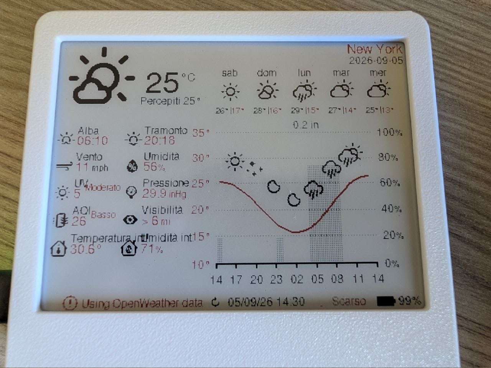
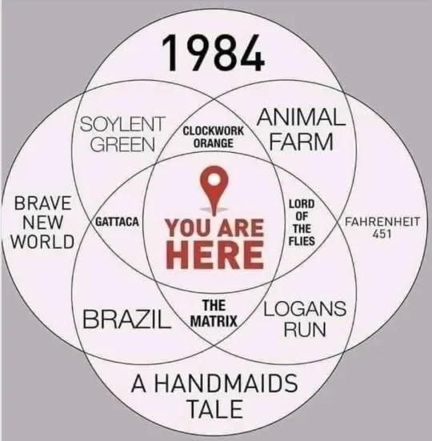

> *raffigurazione della divisione del tempo di un monaco benedettino*

Purtroppo per chi mi legge, sono ancora vivo, vi informo di qualche piccola novità e vi farò venire un po' di *appocundria*. Ho tentato di trovare il tempo per scrivere questo post dall'inizio di Settembre. Non è nella forma che volevo, è un po' _forzato_ ma è il meglio che sono riuscito a fare.

## iscritto all'università!
Sto studiando per la magistrale in Ingegneria Informatica, curriculum Artificial Intelligence Engineering.
Vi dico solo che è tosta ed arrivo la sera distrutto.

## la tristezza della fine dell'estate
Quest'anno ho vissuto il mio primo, vero periodo di 'tristezza dopo l'estate'. Fino ad ora l'ho sempre sperimentata nel mondo scolastico ed universitario con l'inizio di una nuova sessione d'esami.

Ora assisto al ronzio di freddi ingranaggi aziendali che ricominciano a girare, tutti rientrano dalle ferie e si ricomincia a lavorare, nuovi progetti, features in cantiere. Poi c'è sempre qualcuno che fa ancora qualche riferimento nostalgico alle settimane di vacanza... poveri illusi.

## telefono nuovo
Il mio Poco F5 aveva un problema al sensore di impronte nelle ultime settimane.  **#**    
Poi, assieme alla ROM moddata ed alle strette di Google per rendere la vita dei modder sempre più dura (pagamenti con NFC che non funziona, applicazioni che rilevano che il dispositivo non è 'genuino'...), in un momento di debolezza, ho ceduto e ho comprato il Google Pixel 11 Pro. 

La motivazione dell'acquisto è che in tutti i telefoni che ho posseduto, sono sempre stato incantato dalle ROM AOSP, quindi quell'Android Stock, simil-pixel, senza fronzoli, minimale il giusto, funzionale. 

Devo ammettere che la qualità costruttiva è bellissima, per me pari ad iPhone, e la fotocamera è spettacolare. Ho comprato il telefono in perfetto blind, ma sapevo che i SoC Tensor non sarebbero stati chissà ché. Per i miei utilizzi (no gaming) va benissimo. Però ti lascia sempre quella mancanza, quella sete di volere il top del top.  Altra nota dolente è la batteria, dura poco e la ricarica da 30W è un po'lentina dopo il 70%. Data la spesa piuttosto significativa, ho comprato il top del top come protezione per il vetro e cover.

 **#** inizialmente pensavo che il problema fosse il sensore di impronte, magari l'acqua di mare aveva fatto il danno. Attendo così pazientemente il pezzo di ricambio dalla Cina, lo monto con molta pazienza (era davvero un coso piccolino ed il cavo andava piegato in mille modi).   Niente da fare.   Compro il telefono nuovo, migro tutto lì, a quel punto inizio a flashare il sistema operativo stock e PAM! il sensore funziona. Cristian avresti potuto aspettare almeno un altro anno prima di comprare il telefono. 

## progettino nuovo ESP32
Tra gli acquisti c'è anche un [ESP32 mezzo pre-configurato della RockBase](https://github.com/RockBase-iot/NM-EPD-420) con cui mi divertirò a fare un po' di domotica col C++.

L'obiettivo nel tempo libero sarà:
- impratichirmi un po' col modding e flashing (che in realtà ho già appena testato, è di una semplicità disarmante);
- capire come installarci un sensore di quelli per la qualità dell'aria come il SENSIRION SEN66-SIN-T che rileva anche quanti peli del culo fluttuano nella vostra stanza;
    - va capito dove va saldato e poi come leggere i dati e renderli visualizzabili sul display.
- idealmente, salvare i dati delle misurazioni:
    - non so se sia capace ma mi piacerebbe salvare tutti i record su un database sqlLite nella sua scheda microSD;
- la parte più difficile di tutti è creare una nuova scocca da stampare con una stampante 3D che possa ospitare sia il nuovo sensore che l'attuale chip. È qualcosa di inesplorato per me e richiederà un po'di pratica.

## we are so doomed 
è molto scoraggiante leggere dall'ONU che siamo senza scampo e non è più possibile invertire il surriscaldamento globale, ma è possibile per il momento tentare di non peggiorarlo (se è come avete fatto fin'ora, andiamo alla grande).
Mi sento alienato ormai da questa incertezza incessante sul nostro futuro. Vorrei essere stordito e vivere con serenità la vita ma ovunque io guardi vedo solo disperazione, mi dà una sensazione di impotenza paralizzante. Vorrei solo poter spegnere il cervello e sentirmi completo, senza alcun bisogno, aspirazione da ricercare, dove bisogna affrontare mille ostacoli (anche quotidiani) per ottenere qualcosa. La mia generazione sta per affrontare minacce enormi totalmente al di fuori del nostro controllo e pretendere di avere la forza di scalare le proprie montagne personali richiede uno sforzo emotivo mastodontico. Ultimamente ho difficoltà nel concentrarmi a lungo ed ho smesso di leggere, non so se per questi motivi.

Vi lascio questo link di un reel su instagram sull'argomento: [https://www.instagram.com/reel/Dc114cchhht/?stkn=N21ocXNlMDh5dXh1](https://www.instagram.com/reel/Dc114cchhht/?stkn=N21ocXNlMDh5dXh1) 

# Cosa sto leggendo

Forse non è stato saggio aver seguito questa immagine per trovare i nuovi libri da leggere, che sono i seguenti, ho iniziato solo il primo:
- Il racconto dell'ancella | Margaret Atwood
- La fuga di Logan | William F. Nolan, George Clayton Johnson
- Largo Largo | Harrison Harry

In realtà, ho sottomano anche altri libri ma credo di non avere il mood adatto per sopportarli, dovrebbero essere proprio libri in cui vi è una paralisi collettivi, il mondo è in frantumi ed i personaggi sono rassegnati al loro destino:
- I figli degli uomini | P.D. James
- Febbre | Ling Ma
- Imparare a morire nell'Antropocene | Roy Scranton
- La strada | Cormac McCarthy