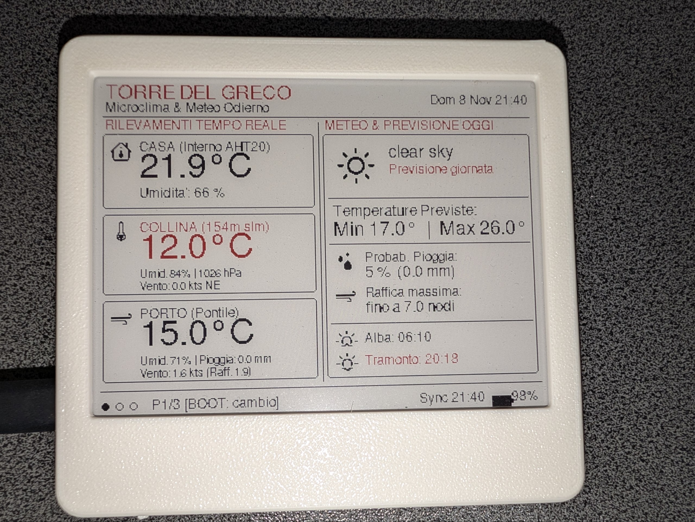
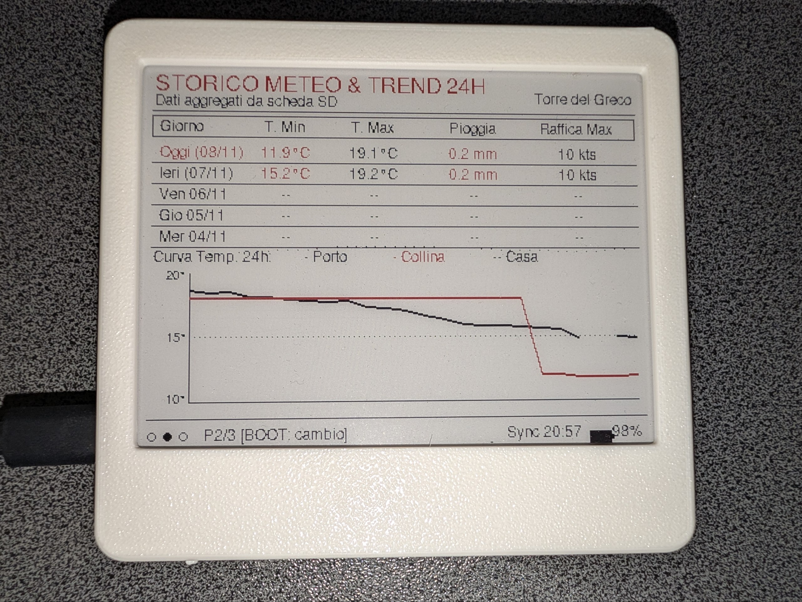
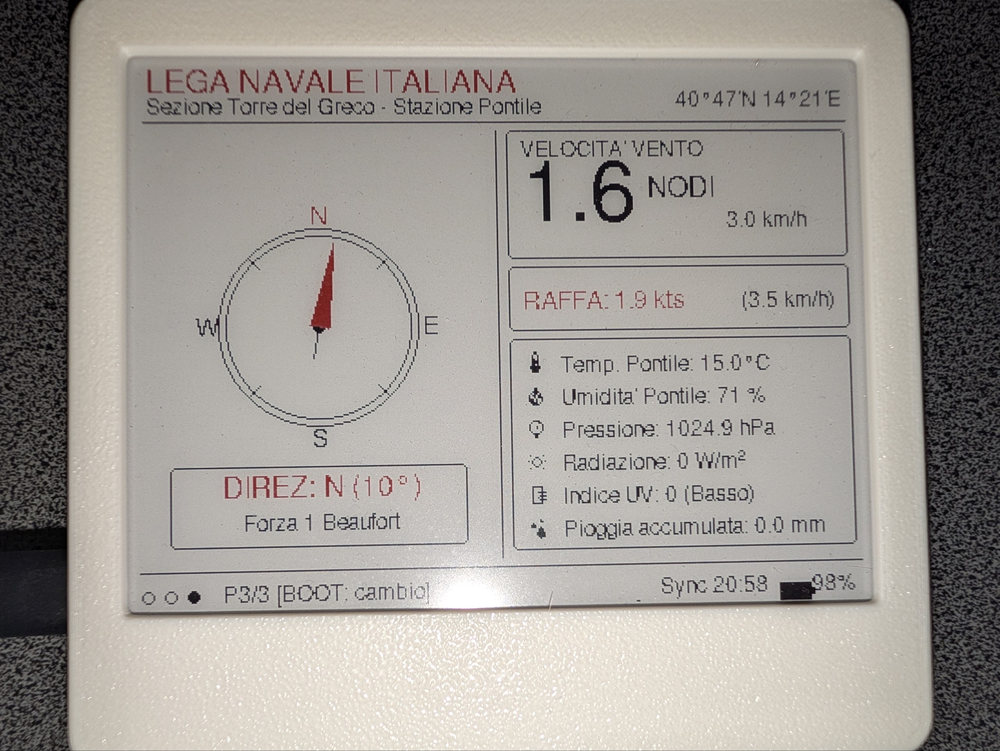

### Carrellata di foto del risultato





## Cosa è stato fatto

In questo lungo periodo di tempo ho trovato innanzitutto vari servizi di 'weather live' di Torre del Greco, ne ho reputati interessanti 2, consiglio anche di andarli a visitare che son pucciose assai:


[Stazione meteo Torre del Greco su CampaniaLive](https://www.campanialive.it/dati-meteo.asp?stazione=torredelgreco)

[Meteo della Base Nautica Lega Navale](https://www.leganavaletorredelgreco.it/meteo/)

Con questi dati a disposizione, inizia la parte difficile.


Ho delimitato il perimetro di ciò che mi è possibile fare con i sensori attuali ed ho deciso di avere schermate differenti per alcune informazioni nel dettaglio.
Il primo sito ne ha molte poche, il secondo invece è particolarmente dettagliato sui venti ed irraggiamento solare. Ho appurato di aver bisogno di almeno 3 schermate, che sono quelle presenti negli screenshot in alto.

Un altro obiettivo che mi sono posto è stato quello di sfruttare le capacità della scheda per salvare tutte le letture periodiche eseguite dal microcontrollore, in modo da avere una cronologia delle misurazioni.


## Raffinamenti Successivi

- La parte di scraping dei dati è risultata parecchio ardua, fare scraping con un dispositivo con un buffer di memoria così piccino richiede più inventiva del necessario, inoltre il sito della lega nautica ha vari filtri per evitare che avvengano questi tentativi di letture automatizzate pertanto inizialmente era impossibile recuperare i dati con semplicità.

- in assenza di wifi o fallimenti nelle varie fasi, il software di default mostrava un punto esclamativo al centro dello schermo. Volevo evitare che accadesse questo per renderlo sempre consultabile, ed ecco perché dovevo rendere i dati persistenti su una memoria microSD. Pertanto è stata prevista una serie di azioni di questo tipo:
    - collegati al wifi
    - ottieni il tempo (data ed ora) attuale
    - collegati a CampaniaLive ed estrai i dati
        - salva su un file .csv ed aggiorna il file latest.json
    - collegati a Base Nautica ed estrai i dati
        - salva su un file .csv ed aggiorna il file latest.json
    Con qualche ricerca su internet e passando tutto a Gemini è stato molto semplice capire come montare e scrivere sulla schedina.
    Non ho optato per un db (come sqlite) in quanto ho reputato lo sforzo non necessario, sia computazionalmente parlando che cognitivo. Simple is better.

- Avevo poi necessità di definire una nuova UI per mostrare i dati ed abilitare un tasto per lo scorrimento delle varie interfacce.
    - questa è la parte più acerba del progetto, al momento ho notato un bug sul grafico dell'andamento delle temperature nei 3 luoghi, in particolare, il grafico delle temperature di casa non compaiono (probabilmente perché fuori scala).
    - altro bug è l'errato orario di alba e tramonto, dati raccolti da OpenWeather, il provider di default presente sul software.

- Per rendere il tutto più divertente, ho scoperto che la repository git che ero riuscito a clonare mesi fa è stata stranamente chiusa, non è più raggiungibile:
```bash
❯ git fetch
remote: Repository not found.
fatal: repository 'https://github.com/RockBase-iot/esp32-weather-epd.git/' not found
```

    Non è un grosso problema, in quanto si riesce a trovare la stessa repository inserita da altra gente su github. 


Ora mi scoccio di scrivere altro quindi tenetevi sto coso così com'è.